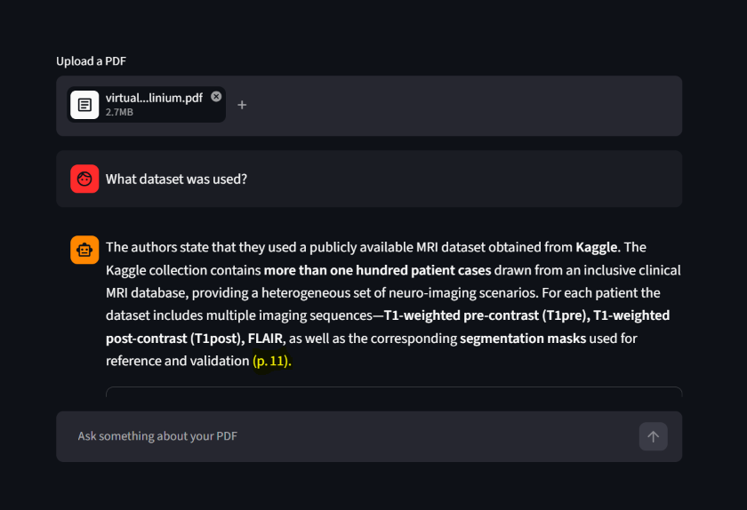

# 📄 Chat with your PDF

A Retrieval-Augmented Generation (RAG) app: upload a PDF, ask questions in plain language, and get answers with **page-number citations** so every claim can be verified.

**Live demo:** https://rag-pdf-chatbot-laiba.streamlit.app



## Features

- Upload any text-based PDF and chat with it
- Answers cite the source page, e.g. `(p. 11)`
- "Sources" panel shows the exact excerpts used for each answer
- Answers only from the document; replies "I couldn't find this in the document" when the answer is missing
- Prompt designed to separate an author's own claims from what they say about prior work

## How it works

1. **Extract** text from each page with `pypdf`
2. **Chunk** pages into overlapping pieces (1000 characters, 200 overlap), keeping the page number as metadata
3. **Embed** chunks with `sentence-transformers` (`all-MiniLM-L6-v2`) and store them in **ChromaDB**
4. **Retrieve** the 6 chunks most similar to the question
5. **Generate** an answer with an LLM served by **Groq** (`openai/gpt-oss-120b`), using only the retrieved excerpts

## Tech stack

Python, Streamlit, ChromaDB, sentence-transformers, pypdf, Groq API

## Run locally

```bash
git clone https://github.com/laibaghalib/rag-pdf-chatbot.git
cd rag-pdf-chatbot
python -m venv venv
venv\Scripts\activate        # Windows
pip install -r requirements.txt
```

Create a `.env` file with your Groq API key:

```
GROQ_API_KEY=your_key_here
```

Then run:

```bash
streamlit run streamlit_app.py
```

## Limitations

- Works on text-based PDFs only; scanned (image-only) PDFs are not supported
- Text inside figures and charts is not read
- Tables and multi-column layouts may be extracted out of order
- The index lives in memory and is rebuilt for each uploaded PDF
- Free-tier hosting and API limits apply, so the demo may be slow or rate-limited

## Author

Laiba Ghalib, [LinkedIn](https://www.linkedin.com/in/laiba-ghalib/)